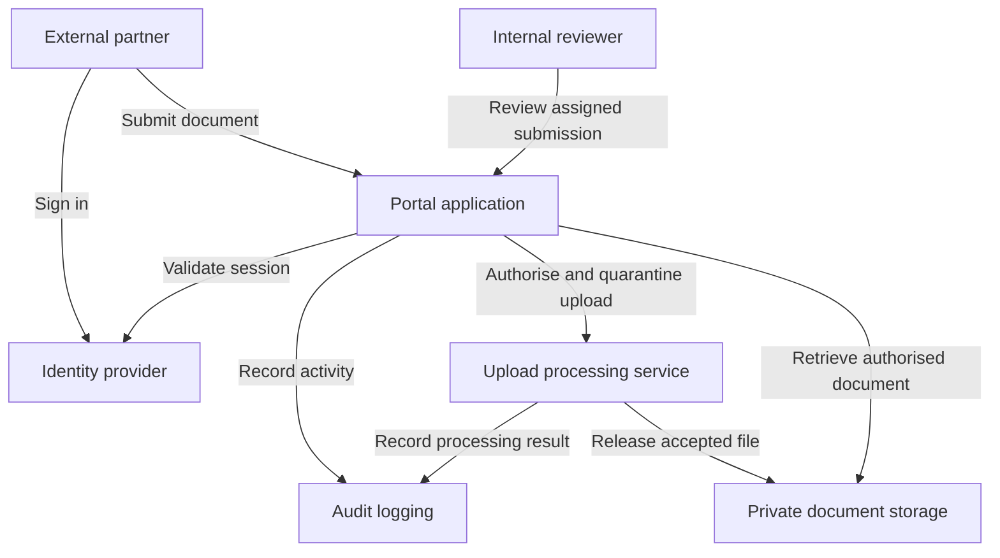

# threat-modelling-examples

# Threat Modelling Examples

Practical examples exploring how to identify security threats and recommend controls during system design.

Created by **Shiva Boodoo**, a cybersecurity professional based in Trinidad and Tobago.

> These examples use fictional systems for learning and discussion. They do not describe any organisation’s internal infrastructure.

## Example 1: Online Document Submission Portal

### Scenario

A regional organisation needs a portal where external partners can submit sensitive documents. Internal reviewers assess submissions, while administrators manage accounts and permissions.

The objective is to protect documents, restrict access and maintain a reliable record of activity.

### Scope and Assumptions

This example covers authentication, document uploads, storage, reviewer access and audit logging.

Assumptions:

- External users authenticate through an identity provider.
- Each partner organisation must have access only to its own submissions.
- Reviewers receive access to assigned submissions.
- Uploaded documents are treated as untrusted.
- The identity provider and hosting infrastructure require separate assessments.

### Proposed Architecture

### Assets to Protect

| Asset | Security requirement |
|---|---|
| Submitted documents | Confidentiality and integrity |
| User accounts and sessions | Protection against unauthorised use |
| Submission ownership and review status | Accurate records and controlled changes |
| Audit logs | Reliable evidence of user and administrator actions |
| Portal service | Availability for submissions and reviews |

### Trust Boundaries

1. **Internet to application:** Requests and uploads enter from untrusted devices.
2. **Application to identity provider:** Authentication results must be validated.
3. **Partner to partner:** One partner must not access another partner’s information.
4. **Application to storage and processing:** Service identities require restricted permissions.
5. **User to administrator:** Administrative functions require additional privileges.

### Threat Assessment

STRIDE categories help structure this assessment. Priorities are illustrative and require validation against the actual environment.

| ID | Category | Threat scenario | Recommended controls | Priority |
|---|---|---|---|---|
| T01 | Spoofing | An attacker uses a compromised partner account to access documents. | Require MFA, protect sessions and monitor suspicious sign-ins. | High |
| T02 | Tampering | A user changes a submission identifier to modify another partner’s record. | Enforce server-side authorisation for every object and action; protect ownership fields. | High |
| T03 | Repudiation | A user denies submitting a document or changing its review status. | Record actor, action, timestamp, object and outcome in access-controlled audit logs. | Medium |
| T04 | Information disclosure | A document becomes accessible through a public storage link. | Use private storage, authorise downloads and limit the lifetime of any generated access links. | High |
| T05 | Denial of service | Repeated requests or oversized uploads exhaust application resources. | Apply request limits, upload size limits, processing timeouts and storage quotas. | High |
| T06 | Elevation of privilege | A partner manipulates a request to invoke an administrator function. | Deny access by default and enforce role checks on every privileged endpoint. | High |
| T07 | Tampering | A malicious upload exploits a document processor and compromises stored information. | Quarantine uploads, validate file types, scan files and isolate processing with restricted permissions. | High |

### Verification Plan

Use an authorised test environment with synthetic accounts and documents.

- Confirm Partner A cannot view, download or modify Partner B’s submissions.
- Confirm partner accounts cannot invoke reviewer or administrator functions.
- Confirm rejected uploads remain unavailable to reviewers.
- Confirm direct unauthenticated requests cannot retrieve stored documents.
- Confirm important actions produce complete audit records without logging document contents or credentials.
- Confirm configured upload and request limits are enforced.

### Residual Risks

- Malware scanning may miss new or evasive threats.
- Authorised users may misuse documents they can legitimately access.
- Identity-provider outages may prevent access.
- Incorrect permissions or application changes may introduce new exposure.

### Design Decisions

- Keep document storage private.
- Enforce authorisation on the server for each submission.
- Process uploads before making them available for review.
- Separate partner, reviewer and administrator permissions.
- Review the threat model when workflows, integrations or access rules change.

## Feedback

Suggestions and alternative approaches are welcome through repository issues.
